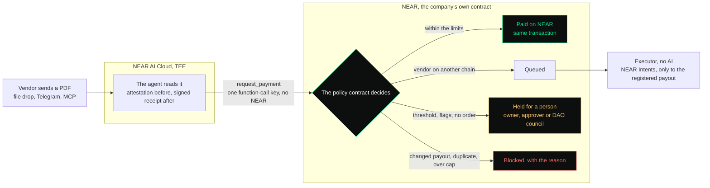

<p align="center"></p>

<h1 align="center">Bursar</h1>

<p align="center"><strong>An AI treasurer that pays invoices within limits it cannot change.</strong><br>The AI reads. The contract decides. A dumb executor moves the money.</p>

<p align="center">
<a href="https://bursar.network/console">Console</a> &nbsp;·&nbsp;
<a href="https://bursar.network/explorer">Explorer</a> &nbsp;·&nbsp;
<a href="https://bursar.network/docs">Docs</a> &nbsp;·&nbsp;
<a href="WHITEPAPER.md">White paper</a> &nbsp;·&nbsp;
<a href="ROADMAP.md">Roadmap</a>
</p>

<p align="center">


</p>

Built for NEAR HACKATHON (November 1 to 14, 2026). Tracks: `realworld`, `business`, `privacy`, `security`. Development started on October 20, 2026; the project was completed, tested and submitted during the hackathon, and the commit history is kept as it is.

## The problem

Every company pays invoices. The two things that go wrong are boring and expensive: someone pays a fake invoice (the "please note our new bank details" fraud, the most common business scam in the world), and someone pays the same invoice twice. Letting an AI do the work makes both worse, unless the AI never holds the keys.

## What Bursar does



1. An invoice PDF lands in the inbox.
2. The **agent** reads it inside a TEE on NEAR AI Cloud. The invoice never leaves the enclave in clear text; the model's answer comes with an attestation and a signed receipt.
3. The agent asks the **policy contract** on NEAR to pay. It signs with one function-call key that can only call `request_payment`, and sends it as a meta transaction, so the agent owns no NEAR at all.
4. The **contract** decides, deterministically and on chain:
   - vendor must be in the owner's allowlist
   - the payout printed on the invoice must equal the payout the owner recorded (otherwise `payout_changed`)
   - no duplicate invoice numbers per vendor
   - per-payment cap, per-vendor monthly budget, daily cap
   - at or above the approval threshold: a Sputnik DAO proposal is opened, a human approves it in Trezu; the proposal id is written back on the payment, and a rejected or expired proposal cancels it. The DAO that `setup` and the console create asks a 0.1 NEAR bond per proposal (Sputnik's default is 1 NEAR); the treasury pays it and gets it back when the council decides, and when the account cannot cover a bond the invoice still waits, without a proposal, until someone opens it or tops the account up; a DAO created earlier with the 1 NEAR default is moved to 0.1 NEAR from the console (Settings, Governance: one proposal, voted with the owner's seat)
5. Payment:
   - vendor on NEAR: USDC is transferred in the same transaction (`Paid`)
   - vendor on Base, Arbitrum, Solana or Sui: the **executor** (a plain process with the company's key, no AI) gets a NEAR Intents quote (EXACT_INPUT on the net amount the contract will send, fee capped at 2 percent) with the vendor's recorded address as recipient and calls `settle`. The contract releases USDC only if the recipient it reports equals the vendor record (`Settling`, then `Settled`). A refunded settlement goes back in front of a person (`Approval`, reason `settlement_failed`), nothing is re-sent on the executor's own; one nobody can confirm is closed by the owner (`close_settlement`, delivered or not).
   - a USDC transfer that fails on the token contract is rolled back in the callback: balance restored, payment marked `transfer_failed`, nothing lost
6. Everything is an on-chain event. The MCP server lets any assistant drive it, with exactly the agent's powers.
7. Anyone can re-verify the TEE receipt behind a payment, without the API key and without trusting the agent (`bursar verify`).
8. Orders: the owner records what the company agreed to buy (a purchase order with a total, or a standing order per period). An invoice outside them, or one the model flagged, is held for a person instead of paid on the AI's word. Operators get on-chain roles (approve, manage vendors, manage orders), revocable by the owner.

The AI never chooses an address. NEAR vendors are paid by the contract itself, to the payout the owner recorded. Cross-chain vendors are paid through NEAR Intents by the executor, which can only send the USDC to the Intents deposit account the owner registered (`set_settlement_account`) and only for payments the contract queued; a quote that names any other recipient is refused. A payout recorded or changed by an operator pays nothing until the owner confirms it, every payment carries the payout it was checked against and goes nowhere else, and a changed payout on an invoice is a block, not a payment.

## Live on testnet

| | |
|---|---|
| Policy contract | `treasury.bursar-b48563e6.testnet` |
| Agent (one function-call key) | `agent.bursar-b48563e6.testnet` |
| Executor / relayer | `executor.bursar-b48563e6.testnet` |
| DAO (Sputnik v2) | `bursar-bursar-b48563e6.sputnik-v2.testnet` |
| Test USDC | `tusdc.bursar-b48563e6.testnet` |
| Registry (the list of treasuries) | `registry.bursar-b48563e6.testnet` |

Payments 1 to 6 on that contract are the walkthrough below, run end to end on 20 October 2026 with the invoices read by NEAR AI Cloud inside the TEE (every `attestation_ref` starts with `nearai:`): paid, queued, approved by the DAO and paid, blocked for a changed payout, blocked as duplicate, held because no order covers it. Open `web/dashboard.html?network=testnet&treasury=treasury.bursar-b48563e6.testnet` to see them. The two failure paths of step 4, a DAO rejection and a rolled-back transfer, are payments 6 and 7 on the earlier deployment `treasury.bursar-itlecew5.testnet`.

Mainnet deployment with real USDC and NEAR Intents: see the demo post (link added at submission).

## Try it: do X, see Y

Prerequisites: Node 22+, Rust stable with the `wasm32-unknown-unknown` target, `poppler-utils` (`pdftoppm`, `pdftotext`), Python 3 with `reportlab` (only to regenerate the sample invoices).

```bash
git clone <repo> && cd bursar
(cd contracts/policy && cargo test && ./build.sh)
(cd contracts/test-usdc && cargo build --release --target wasm32-unknown-unknown)
cd app && npm install && npm test
```
See: `65 passed` from `cargo test`, `bursar_policy.wasm: 471657 bytes` (smaller if `wasm-opt` is installed), and 13 passing app tests (signature recovery, receipt tampering, a real NEAR AI Cloud receipt, offline parser on the four samples, money parsing).

**1. Create a testnet account** (any wallet, or `near account create-account sponsor-by-faucet-service you.testnet ...` with [near-cli-rs](https://github.com/near/near-cli-rs), `npm install -g near-cli-rs`, which steps 4 and 5c use too) and put its full-access key in `~/.near-credentials/testnet/you.testnet.json`. You need about 25 NEAR: the faucet gives 10 per account, so create three and transfer 9.5 from each of the other two to the first. Step 2 spends about 19.5 of them (the treasury account, the DAO's 6 NEAR, the test token, the sub-accounts); what is left pays the gas of the steps below. RPC defaults to FastNEAR (`rpc.testnet.near.org` answers 429 these days); set `NEAR_RPC` to use another node.

**2. Deploy everything with one command.**

```bash
npx tsx src/cli.ts setup --root you.testnet
```
See: sub-accounts for treasury, agent, executor and two vendors; a throwaway tUSDC token; a Sputnik DAO with you as council and a 0.1 NEAR proposal bond; the policy contract deployed and funded with 15,000 tUSDC; four vendors, each with the tax id it prints on its invoices, one of them a freelancer with a 20% withholding set on it; three orders recorded (hosting 500 USDC a month, purchase orders PO-2026-118 and PO-2026-104); the treasury listed in the public registry (`listed treasury.you.testnet in the registry`); the agent left with a single function-call key; `.env.testnet` written; sample invoices regenerated with your vendor accounts.

**3. Start the relayer and process the inbox.**

```bash
set -a; source .env.testnet; set +a
npm run relayer &
mkdir -p ../invoices/inbox && cp ../invoices/samples/0[1-4]-*.pdf ../invoices/inbox/   # the first four; 5 to 9 are for the steps below
npm run agent -- --once --offline      # drop --offline to read with NEAR AI Cloud (needs NEAR_AI_API_KEY)
npm run dev status
```
See, in `status` (the account names are yours; the same four decisions are live on the contract above):

```
#1 acmehosting   AH-0923   480.00 USDC  Paid                      <- NEAR vendor, under caps: paid in the same tx
#2 designco      DC-1107  1250.00 USDC  Queued                    <- Base vendor: waits for the executor (Intents, mainnet)
#3 legalpartners LP-2210  9800.00 USDC  Approval over_threshold dao#0  <- above 2,000: DAO proposal 0 opened by the contract
#4 acmehosting   AH-0924   480.00 USDC  Blocked payout_changed    <- "please note our new wallet": refused
```
and in the relayer log, the agent's meta transactions paid by the executor account.

**4. Approve the big one as the DAO council.** The DAO account is the one `setup` printed, `bursar-<your root without .testnet>.sputnik-v2.testnet`:

```bash
near contract call-function as-transaction bursar-you.sputnik-v2.testnet act_proposal json-args '{"id":0,"action":"VoteApprove"}' prepaid-gas '300 Tgas' attached-deposit '0 NEAR' sign-as you.testnet network-config testnet sign-with-keychain send
npm run dev status
```
See: `#3 ... Paid`, and the vendor's tUSDC balance up by 9,800. On mainnet the same proposal shows up in Trezu and is approved with one click.

If the council votes `VoteReject` instead, Sputnik does not call anyone back. Run `npm run dev sync`: the contract asks the DAO for the proposal status and, only on the DAO's own answer, cancels the payment and releases its budget. See: `#6 dao#1: Rejected` and `#6 ... Cancelled dao_rejected` in `status` (payment 6 on `treasury.bursar-itlecew5.testnet` is exactly that). The executor runs this check on every tick.

A vendor whose NEAR account is not registered on the token contract makes `ft_transfer` fail. The contract's callback puts the money back: `Blocked transfer_failed`, balance unchanged (payment 7 on `treasury.bursar-itlecew5.testnet`).

**5. Send a duplicate.**

```bash
cp ../invoices/samples/01-acme-hosting-0923.pdf ../invoices/inbox/again.pdf && npm run agent -- --once --offline
```
See: `Blocked duplicate_invoice`.

**5b. A registered vendor invents an invoice.** Right account, right amount, under every cap: the one case a bank, an employee and most tools would pay. Bursar pays only what the company agreed to buy. `setup` recorded a standing order for Acme (500 USDC a month, one invoice per month) and purchase orders for the two projects; invoice 1 consumed November's hosting slot, invoices 2 and 3 print their purchase order numbers.

```bash
cp ../invoices/samples/06-acme-hosting-1002.pdf ../invoices/inbox/ && npm run agent -- --once --offline
npm run dev status
```
See: `#6 acmehosting AH-1002 290.00 USDC Approval no_order dao#1`: not blocked, not paid, held for a person. With a DAO the council votes; without one the owner or an approver calls `approve_payment` or `cancel_payment`. Invoices the model flagged (urgency, new payment details) are held the same way, reason `flagged`: the AI can add scrutiny, never remove it. `set_order_policy true` makes every invoice need an order; by default only vendors that have orders are held to them.

**5c. Identity on the invoice.** Names can be imitated; tax ids cannot. `setup` recorded the VAT number each vendor prints on its invoices, so the contract compares it with the one the model read. Invoice 7 is "Acme Host GmbH", a look-alike with another VAT number that asks to be paid to Acme's registered account:

```bash
cp ../invoices/samples/07-acme-host-gmbh-3001.pdf ../invoices/inbox/ && npm run agent -- --once --offline
```
See: `#7 acmehosting AHG-3001 480.00 USDC Approval no_order+identity_mismatch`: held for a person, with every reason the contract found (a second Acme invoice in the same period, and not Acme's tax id), not a guess from the name. Now record your own tax id, so every invoice must be addressed to you, and send invoice 8, a real Acme invoice addressed to another customer:

```bash
near contract call-function as-transaction treasury.you.testnet set_company json-args '{"name":"Northwind Studio","description":"","country":"IT","tax_id":"IT01234567890"}' prepaid-gas '30 Tgas' attached-deposit '0 NEAR' sign-as you.testnet network-config testnet sign-with-keychain send
cp ../invoices/samples/08-acme-hosting-1003-other-customer.pdf ../invoices/inbox/ && npm run agent -- --once --offline
```
See: `#8 acmehosting AH-1003 480.00 USDC Approval no_order+buyer_mismatch`. Both identity reasons are holds, not blocks: a tax id read wrong must not refuse a real invoice, it must have a person look. In the console the same lives in Vendors ("Identifier", per vendor) and in Settings, Company. Spaces and punctuation in the ids do not matter.

The reading itself is cross-checked without trusting the model: the total must appear in the PDF's text layer, no larger amount may appear in it, subtotal plus tax must equal the total when the invoice shows them, the model's confidence must be at least 0.6, and the currency must be USDC. Each failure is a flag, and the contract holds anything flagged (`Approval flagged`); a scan with no text layer is always held. A misread amount can therefore pay less than the invoice, never more than the document shows, never to another account, and never past an order or a cap.

**5d. Withholding tax, set by your accountant.** Bursar knows no tax rules; the company's accountant sets, per vendor, what to keep back (ritenuta d'acconto in Italy, TDS in India, retencion in Spain and Latin America), and the contract applies it. `setup` registered `consultant`, a freelancer, with country IT and a 20% withholding. Invoice 9 is theirs: total 1,000, withholding 200 shown, net payable 800.

```bash
cp ../invoices/samples/09-studio-bianchi-0044.pdf ../invoices/inbox/ && npm run agent -- --once --offline
npm run dev status
```
See: `#9 consultant SB-0044 1000.00 USDC Paid`, the vendor's tUSDC balance up by 800, and in `status` the line `withheld for the state, to remit 200.00 USDC`: the 200 never left the treasury, it is earmarked. Budgets and caps count the gross. An invoice that shows a different withholding than the rate set, or shows one for a vendor with none set, is held (`Approval withholding_mismatch`). The withheld share is the vendor's money paid to the state on its behalf, and remitting and filing stay with the company and its accountant (in Italy the F24, the Certificazione Unica and the 770): Bursar talks to no tax authority. When the company has paid the state, the owner calls `mark_withholding_remitted` (in the console: Analytics, "Mark as remitted") and the counter goes down; the USDC leaves with the usual `withdraw`.

**6. Verify the TEE receipt yourself.** With `NEAR_AI_API_KEY` set, step 3 reads the invoices inside the enclave and writes one receipt per payment in `app/.bursar/receipts/<id>.json`: the exact request and response bytes, the gateway's ECDSA signature, the attestation report with the Intel TDX quote, and the nonce the agent chose. Anyone with that file can check it, without the API key:

```bash
npm run dev verify 1
```
See, one line per check:

```
 ok  bytes                request and response hashes match the stored bytes
 ok  signed_text          signed text is z-ai/glm-5.3-flash:eea8915f29c4cca26e450...
 ok  signature            ECDSA signature recovers to 0x3b753b4406613c5e70ae640508632b600424fa0c
 ok  signer_kind          signed inside the model TEE (provider_tee)
 ok  attestation_signer   attestation report lists signer 0x3b753b4406613c5e70ae640508632b600424fa0c
 ok  attestation_nonce    report echoes our fresh nonce
 ok  quote_report_data    TDX quote report_data binds signer and nonce (mrtd df4d77c857de652b...)
 ok  quote_tcb            quote verified against Intel collateral: TCB UpToDate
 ok  extraction           the claim was built from exactly this model output
 ok  completion_id        completion id 9b1bbd6b036041ea8a8d9b83a7ba26be
 ok  attestation_ref      claim carries nearai:z-ai/glm-5.3-flash:9b1bbd6b036041ea8a8d9b...
 ok  on_chain             payment #1 on treasury.you.testnet carries this reference
verified: the decision was made on this model output, inside an attested TEE
```
Change one byte of the response in the receipt and run it again: `FAIL signed_text`, `FAIL extraction`. Receipts written with `--offline` have no AI receipt and fail at the first line, as they should.

To try the enclave reading without a treasury, relayer or NEAR account, read one invoice and stop there:

```bash
NEAR_AI_API_KEY=... npm run dev read ../invoices/samples/04-acme-hosting-0924-fraud.pdf
```
See: the extraction as JSON (`"flags": ["new_payment_details", "urgency"]`), the claim the agent would have sent, the receipt path `app/.bursar/receipts/read-04-acme-hosting-0924-fraud.json`, and the same check list as above minus `on_chain`. Nothing is submitted: the vendor id is the model's guess, and only the contract matches it against the allowlist.

Without any key at all, check the receipt behind payment #1 on the live contract (invoice 1, read by `z-ai/glm-5.3-flash` on 2026-10-20, kept in the repo as a test fixture):

```bash
BURSAR_TREASURY=treasury.bursar-b48563e6.testnet npm run dev verify test/fixtures/receipt-01-acme-hosting-0923.json
```
See: all the `ok` lines above, `quote_tcb` included (the Intel collateral is fetched live) and `on_chain` (the reference is read from the contract). The file holds the exact request (with the invoice page as PNG), the exact response, the signature and the attestation report with the TDX quote and GPU evidence: 444 KB, nothing secret.

**7. Drive it from an assistant (MCP).** Add to Claude Desktop, Claude Code or Codex:

```json
{ "mcpServers": { "bursar": { "command": "npx", "args": ["tsx", "src/cli.ts", "mcp"], "cwd": "<repo>/app", "env": { "NEAR_NETWORK": "testnet", "BURSAR_TREASURY": "treasury.you.testnet", "BURSAR_AGENT": "agent.you.testnet", "BURSAR_EXECUTOR": "executor.you.testnet", "BURSAR_USDC": "tusdc.you.testnet" } } } }
```
Then ask: "submit the invoice at invoices/samples/04-acme-hosting-0924-fraud.pdf and explain the decision". See: the tool `submit_invoice` returns `Blocked payout_changed`, and `explain_decision` says why in plain words. `verify_attestation` runs the checks of step 6; `sync_dao_approvals` the DAO check of step 4.

**8. Explorer and dashboard.** Open `web/explorer.html` (a static file, no build; live at `https://bursar.network/explorer`). See: every treasury on the network, read from the registry contract and verified against each policy contract (`1 registered, 1 verified` plus yours after step 2), the totals across companies (treasury balance, paid out today, this month and all time, decisions, blocked, waiting for a person) and the last decisions of every company, with no vendor names and no invoice numbers. On testnet the registry also holds the load test of 21 October: ten invented companies (`treasury.bursar-big-*.testnet`, names like Northwind Studio Srl) plus the earlier `Stress Co` treasuries, with every decision the contracts took on 1030 generated invoices still on chain, read from the chain by this page like any other. `web/dashboard.html?treasury=treasury.you.testnet` is one company's own page: balance, caps, vendors with their monthly budget, and every payment with its decision, DAO proposal, destination transaction and attestation reference, all read from the RPC.

**9. Be the customer, from a browser.** `web/login.html` is the door (live at `https://bursar.network/login`): pick the network, press "Continue with NEAR wallet" and choose your wallet in the picker (NEAR Connect: Meteor, Intear, Nightly, Near Mobile and Unity on testnet; HOT and OKX too on mainnet; with the Meteor browser extension installed, the Meteor entry goes through the extension). The wallet tells the page who you are; the page asks the registry for the treasuries that account owns and checks each one's `get_roles`. If there is one, pick it and the wallet adds a key limited to that contract to your browser: the everyday methods only (vendors, orders, limits, approvals, operators, the vault), never a withdrawal, a change of owner or roles, or a new contract build; those the wallet itself signs, and shows you first. If there is none, the page creates the company's treasury at this first sign-in, at no cost to you, in three small windows: your company (name, what it does, country; tax id optional), the creation itself, and how invoices are read (Bursar's relay or your own NEAR AI Cloud key, plus a keys backup). Under the hood it asks the testnet faucet for a payer account, deploys the policy contract from `web/contracts/bursar_policy.wasm`, creates an agent with one function-call key, mints 15,000 test USDC, registers the three demo vendors and their orders, hands the contract to your wallet account with `transfer_ownership`, and lists it in the registry; then "Connect the wallet key" asks the wallet to approve one transaction, the key for this treasury. See: `OK account`, `OK contract`, `OK company`, `OK agent`, `OK usdc`, `OK vendors`, `OK orders`, `OK owner ... is owned by you.testnet`, `OK registry`, then the console with "you.testnet, owner, wallet key" at the bottom of the sidebar and your treasury counted in the explorer. The payer account's key stays in the browser (and in "Download the keys") to fund invites and the DAO, which need NEAR deposits a wallet key cannot attach; it holds no power over the contract. The other doors: an invite link from a colleague, a keys file from a treasury created with throwaway keys, and "Try it with throwaway keys" for a browser with no wallet at all (same creation, the browser's own key as owner). No password and no server.

`web/console.html` is the back office (live at `https://bursar.network/console`): nothing to install, every number read from the contract and every change signed in the browser. Pages: Overview (balance, what waits for a person, last decisions), Invoices (read, receipt, decide), Attention (approve or cancel what is held, see what was refused and why), Vendors (allowlist, payouts, budgets), Orders (purchase orders and standing orders), Analytics (spend by vendor and by month, straight from the payments), Settings (company, limits, strict order mode, operators with on-chain roles, keys). Several treasuries live side by side in the switcher at the top of the sidebar. Collaborators: in Settings, "Invite a collaborator" creates an account for them with one key limited to the methods of their role (approve, vendors, orders), records the role in the contract, and gives you a link that carries the key after the hash sign, so it never reaches a server; send it however you like. Whoever opens it is signed in as that account with that role and nothing else. "Remove" next to the operator revokes it on chain. A DAO: in Settings, "Governance", pick the council (you, operators, any NEAR account) and press "Create the DAO": the page calls the Sputnik factory, leaves 2 NEAR in the treasury for proposal bonds and points the contract at the DAO; from then on every held payment opens a proposal, and council members vote in Attention (or in Trezu on mainnet). Then load the recorded readings (the real receipts the enclave signed on 20 October, verified in the page with the same checks as `bursar verify`, Intel collateral included, fetched through the relay) and press "Request payment" on each: Legal Partners `#1 Approval` (no DAO here, so "Approve as the owner" turns it into `Paid`), Acme with a new wallet `#2 Blocked payout_changed`, Acme `#3 Paid`, DesignCo `Queued`. Your contract, your keys, the same decisions as the walkthrough above. To read a PDF live, drop one of the files in `web/samples/`: with "Bursar reading", a hackathon demo convenience, the page goes through Bursar's relay (`relay/worker.js`, a Cloudflare Worker that holds a NEAR AI Cloud key paid by the team and forwards the bytes untouched, so the signature still verifies; daily caps apply); a company using Bursar brings its own NEAR AI Cloud key, and then the invoice goes from the browser straight to the enclave and never passes through Bursar. "Use the demo treasury" points the page at the README deployment instead (read-only without its agent key). See: the PDF rendered to PNG in the browser, the attestation fetched for a fresh nonce, the enclave's answer, then the same receipt checks as step 6 (minus the Intel collateral check) and a "Download receipt JSON" link. The model is `Qwen/Qwen3-VL-30B-A3B-Instruct`, served inside NEAR AI Cloud's TEE with the same attestation and signed receipt: a reading takes 3 to 5 seconds. On 1030 invented invoices of ten invented companies (five layouts, 207 noisy scans without a text layer, 100 multi-page, 67 with new-bank-details fraud, 25 with a deposit already paid, 30 duplicates), read 8 at a time through the relay: 1030 read, 1030 signed, 0 errors, amount right on 1029, payout right on 1006; the payouts read wrong were garbled addresses on scans, refused by the page or blocked by the contract, never paid. The claim takes the amount from the string the model copies off the page, parsed here (European 1.234,56 included) and reconciled with the printed subtotal and tax; a notice of new payment details that points at the registered payout is not a hold, a different payout is refused whatever the notice says. The first receipts in this README were produced by `z-ai/glm-5.3-flash`, the model Bursar used until 21 October; they verify the same way, the model name is part of the signed text. If the gateway answers 502 or 524 the page retries on its own. Press "Request payment": the page signs `request_payment` with the agent key (plain borsh plus ed25519, no NEAR library) and shows the contract's decision, `#7 Paid` on the live contract, with the transaction link. Drop invoice 4 instead: `Blocked payout_changed`. The agent account needs a little NEAR for gas on this direct path (`setup` leaves it 0.5); the CLI agent goes through the relayer and needs none. Invoices can also arrive by Telegram: in Settings, "Connect a Telegram chat" gives a link; open it, press Start, and every PDF posted in that chat (by you, a colleague, or a vendor in a group) appears in the console's Inbox with the sender and the file name, nothing read yet. Press Read: the same enclave reading and the same contract decision as a dropped file, and the bot tells the chat the outcome with the transaction link. The owner can also connect their own Telegram as approver (step 9h): every invoice is forwarded there with the PDF and two buttons, an approved one is read and submitted by the agent, and a held one comes back to the console for the wallet. The relay keeps only the sender, the name and Telegram's file reference; the PDF stays on Telegram until Read (`relay/README.md`, "Telegram inbox", for the bot setup). `web/docs.html` explains all of this in one page. The workflow in `.github/workflows/pages.yml` publishes `web/` with GitHub Pages (enable Pages with source "GitHub Actions" in the repository settings).

**9a. On your phone.** Open `https://bursar.network/console` on the phone and add it to the home screen (Safari: Share, "Add to Home Screen"; Chrome: the install prompt or the menu's "Install app"). See: Bursar as an app with its own icon, full screen, opening on the console; the pages you visited open again without network, the chain and the relay are always asked live. A manifest, three icons and a small network-first service worker (`web/sw.js`), nothing else: keys stay in the page's own storage.

**9b. Charts and the accountant's report.** In the console, Analytics: see spend by month (the lighter top of a bar is the withholding kept for the state), spend by vendor, the mix of decisions, and every payment grouped by vendor with gross, withheld and net. Press "Download the Excel report": see `bursar-<treasury>-<date>.xlsx` with five sheets (Summary, Payments, By vendor, By month, Withholding), amounts as numbers, one row per decision with its reason, invoice hash and enclave completion id. "CSV of all payments" is the Payments sheet alone. Both are built in the browser from the contract; nothing is uploaded anywhere.

**9g. Upgrade the contract from the console.** A treasury created in a browser has no full-access key anywhere, by design. When a new build of the policy contract ships, Settings shows the build the treasury runs (its code hash against `web/contracts/builds.json`) and, to the owner, an "Upgrade contract" button: the wallet signs `upgrade` with the new wasm as its argument and the contract deploys it onto itself and runs `migrate` in the same batch, which brings the stored state to the new layout (idempotent: a state already in the current layout is left alone; the October 20 layout is rewritten entry by entry, covered by a unit test). See: the build label change and every payment still there. Treasuries deployed before this method existed are upgraded once with their treasury key (`near deploy`), after that from the console.

**9h. Approve from your phone.** Settings, Telegram inbox, "Connect your Telegram as approver": open the link, press Start. See the bot answer "You approve invoices for ... from here". Post a PDF in a vendor's chat: see it reach your chat as a message with the PDF attached, the sender, the file name and two buttons, Approve and Reject (with several waiting, reply to the one you mean, or type yes or no under it). The vendor's chat reads "accepted by the company, being processed"; in Inbox the row reads "approved, by you: press Read to send it to the contract". Many waiting at once: type `approve all` in your approver chat, see the list of what waits and one button, "Approve all N", and press it; in the console, Inbox has "Approve all waiting (N)" for the same, and Attention has a checkbox per held payment with "Approve selected" and "Cancel selected" (four `approve_payment` calls per signature; with a DAO, "Vote approve selected", one vote per proposal). Each invoice is still a decision of its own on the contract, with its own limits: bulk means fewer signatures, never fewer checks. Press Read, then "Request payment", as for any inbox item (a company that runs the agent with the inbox token from Settings, Keys, `BURSAR_RELAY=https://bursar-relay.<you>.workers.dev BURSAR_INBOX_TOKEN=<token> npm run agent -- --direct`, sees it take the invoice on its own: `telegram AH-0923.pdf -> payment #N Paid`). Either way the bot posts the outcome under your message: `Paid: AH-0923, Acme Hosting, 480.00 USDC` with the transaction link, or `Held: ... Reason: amount at or above the approval threshold. Open the console to review it and approve with your wallet` with a link straight to Attention, or `Blocked: ... Reason: payout on the invoice differs from the vendor record`. The vendor's chat reads only "paid", "under review at the company" or "declined", never the reason. Approve on Telegram is a yes recorded on the relay, nothing more: whoever presses Read (or the company's agent) signs `request_payment`, a method that can only ask, and the contract applies the same caps, thresholds and holds; a held invoice is approved in the console, with the owner's wallet. No key of any kind lives on the relay. Only the Telegram user who pressed Start with your code can decide, in a group too. Press Reject instead: the row leaves Inbox and the vendor reads "declined". Decide in the console instead of the phone: your Telegram message gets the same outcome under it. For a vendor you would approve anyway, tick "Trusted vendor, accept without asking" when you connect its chat (or the "trusted" box next to it under Connected chats): its invoices skip the question, you only get a notice, the vendor reads "Accepted: the treasury contract decides next", and with the agent running nobody touches anything between the PDF and the payment. The contract still applies every rule, so a changed payout, a cap, a missing order or a flag is held or blocked exactly as before.

**9f. Money that arrived without a call.** Overview has a "Top up" card: the treasury account to send USDC to from any wallet or exchange (as text with Copy, and as a QR code for a wallet that scans one), the NEAR the account has free of its storage (with a warning when it runs low), and for the owner "Deposit USDC" and "Add NEAR" signed from the browser (on testnet also "Mint 10,000 test USDC", test money moved into the treasury in one transaction). See the balance rise at once: a deposit made from the page is an `ft_transfer_call`, which the contract counts in the same transaction, the way the console funds a new treasury. A wallet or an exchange sends USDC with a plain `ft_transfer`: the tokens are in the account, the contract's books do not know. Send some test USDC to your treasury that way (`near call tusdc.bursar-b48563e6.testnet ft_transfer '{"receiver_id":"treasury.you.testnet","amount":"500000000"}' --accountId you.testnet --depositYocto 1`), open the console's Overview: see "The USDC contract holds 500.00 USDC more than this treasury has on its books" and a "Sync balance" button. Press it: the contract asks the token contract itself what it holds (`sync_balance`, owner or operator; a cross-contract `ft_balance_of`, minus the transfers it sent whose callback has not landed, so nothing is counted twice), see the balance rise by 500.00 and the notice gone. Nobody types a number: `balance_synced` in the log carries old, new and in-flight amounts.

**9e. Know the answer before you ask.** Read any invoice in the console: under the claim, before the button, see "will pay", "will wait: ..." or "will be refused: ...". It is `preview_payment`, a view method that runs the contract's checks on the contract's state without recording anything. Deactivate a vendor in Vendors, read one of its invoices: see "will be refused: vendor deactivated by the owner" before you press anything, and the same `Blocked vendor_inactive` if you press.

**9d. One chat per vendor.** Settings, Telegram inbox: pick a vendor in "Who is this chat for" and press Connect; open the link in Telegram and press Start. See the bot answer "Connected ... for the vendor Acme Hosting: invoices from here are expected from that vendor". Post a PDF there: see it in Inbox under "Acme Hosting". Connect a second chat for DesignCo and post Acme's invoice there: Read it and see the flag `chat_vendor_mismatch`; press Request payment and see the contract answer `Approval (flagged)`, a hold for a person, because the chat and the paper disagree. Under Settings, "Connected chats" lists every chat with the vendor it is for; change it or disconnect it there.

**9c. Lose the browser, keep the company.** Sign in with the wallet, connect a Telegram chat (Settings), then in Settings press "Save to the vault": the wallet signs one message, no transaction. See: `vault on chain: saved <now>, up to date` and `get_vault` on the contract returning an opaque `v1:...` string (encrypted in the browser, the contract never reads it). Open a different browser, sign in with the same wallet, pick the treasury: see the green strip "its contract keeps a vault with them"; press "Unlock with the wallet": see the Telegram inbox back, same token. Nothing was stored anywhere but your contract, and nothing on it is readable without your wallet. A person in the console can also press "Request payment" without the agent key: `request_payment` accepts the agent, the owner and the operators, and decides the same way.

**10. Cross-chain payout (mainnet only).** NEAR Intents has no testnet. With `NEAR_NETWORK=mainnet`, real USDC in the treasury and a vendor on Base, `npm run executor -- --once` quotes USDC NEAR to USDC Base with the vendor's address as recipient, calls `settle`, and marks the payment `Settled` with the Base transaction hash.

<details>
<summary><strong>Security audits: three independent rounds, every finding reproduced by a test</strong> (click to read what they found and what changed)</summary>

**Security audit (21 October).** Four independent reviews of the contracts (authorization, accounting and asynchrony, policy logic, storage and gas) plus a line-by-line read, every finding reproduced by a unit test before the fix, then a second round on the patched code. What they found and what changed: a held payment could be approved after the owner paused the treasury or switched the vendor off (approval now re-checks both); the executor could send a queued payment to any NEAR account by naming the right recipient in the quote (it can now only pay the Intents deposit account the owner registered); an operator with the vendors role could redirect a held payment by editing the payout before the council voted (each payment carries the payout it was checked against, and a payout recorded by an operator pays nothing until the owner confirms it); cancelling yesterday's hold freed today's daily cap (counters are released only in their own day and month); withheld tax sat inside the spendable balance (it is now set aside, `remit_withholding` moves it to the owner for the state); a stolen agent key could fill the contract's storage with oversized claims or drain its NEAR into DAO bonds (claim fields are bounded, non-owner callers get daily quotas of requests, refusals and holds, no proposal opens without NEAR for the bond); a bill split into many small invoices met no one (five autopaid invoices per vendor per day, then a person); duplicates were caught only on the exact number (now on the normalized number and on the file hash); a refunded Intents settlement was stuck forever (`mark_settlement_failed` returns it to the queue); a transfer callback that never ran blocked `sync_balance` for good (`reset_in_flight`); a DAO could not be removed (`clear_dao`); ownership could go to the agent key (refused); event logs could be forged with a quote in a vendor id (escaped); the registry trusted any entry (the explorer and the login page now check the code hash of the contract against `web/contracts/builds.json`, and the registry's `claim` asks the treasury itself who owns it). A second round on the patched code found that the first fix for refunded settlements let the executor pay the same queued payment twice; a settlement now goes back to the queue only once the token contract shows the USDC back on the account, quotas are per caller, DAO proposals opened for a non-owner are limited per day and a person can open the missing ones, and the relayer caps gas and calls per hour. What the contract still trusts, on purpose: the claim's flags and tax ids come from the reading and can only add scrutiny, never remove a block; the executor is trusted for the amounts the contract queued, within the settlement account; the approval threshold is per invoice, the daily cap and the vendor budgets are the bounds that hold whatever the agent does.

**Third round (24 October).** Five independent reviewers, told to be aggressive, on the contracts, the relay, the console, the agent and the relayer; every contract finding reproduced by a unit test before the fix (65 tests now). Contracts: approval and settlement checked the net amount against the balance instead of the gross; releasing a hold from an earlier period freed the current period's allowance; a settlement nobody confirmed had no way out (the owner can now `close_settlement`, delivered or not, and a refunded one waits for a person instead of being re-sent); the agent, executor, operator and DAO roles could overlap (kept distinct now); an invoice larger than its purchase order fell back to the standing order; an operator with the vendors role could switch a vendor back on or change its tax id and withholding (owner only now); invoices without a number collided; the withholding tolerance was a percent instead of rounding; a held claim was stored at full size; a failed DAO proposal left the duplicate keys in place; a vendor's order index was missing after migration; `request_payment` refuses when the account is low on NEAR for storage, instead of failing halfway. Off chain: the inbox pairing is signed by the treasury's owner and checked against `get_roles`, each chat is bound to one treasury, and there is no free-text route; the relayer verifies the delegate's signature, that the key is on the agent's account and the expiry before paying any gas, with per-address limits; the treasury account is created together with its contract and never gets an access key, by `setup` and by the console alike, so only the owner's methods can change it, `upgrade` included; the agent verifies the TEE receipt before claiming on it, flags an invoice from a vendor's chat that names another vendor (`chat_vendor_mismatch`), runs poppler with timeouts and per-file folders, and no longer loads a JavaScript PDF parser; the executor quotes EXACT_INPUT on the net the contract actually sends, caps the fee at 2 percent and stops after three failed attempts; the console confirms unknown RPC and relay parameters, refuses an invite for a treasury whose keys it already holds, routes the owner's sensitive methods through the wallet, pins its CDN modules by integrity hash, and locks each vault with a salt of its own (a Content Security Policy with script hashes was tried and dropped: NEAR Connect runs each wallet's code in an iframe that inherits the page's policy, and every non-extension wallet stopped initializing; the pages keep `object-src 'none'`, `base-uri` and `form-action` only). The round also caught its own mistake: the first fix left `upgrade` with too little gas for the deploy fees of a 471 KB build, which showed up as a failed owner upgrade on the key-less demo treasury; the reserve is now 40 TGas, checked by a real owner upgrade on a treasury with no key before the demo was touched again. Left on purpose: an owner's wallet can still be talked into signing `transfer_ownership` (two-step ownership is on the list); the executor is trusted for the destination within the vendor record; the registry remains a hint, verified against the contract by every reader.

</details>

**Unit tests:** `cd contracts/policy && cargo test` (65 tests, one per policy rule and one per finding of the three audit rounds above: pays under threshold, queues cross-chain, blocks changed payout, blocks duplicates and caps, DAO approval flow, owner approval without a DAO, purchase orders consumed then held, standing order one invoice per month, vendors without orders unless strict, model flags add scrutiny, operators and roles, proposal id recorded by callback, failed proposal releases budget, DAO rejection cancels, failed transfer restores balance, executor cannot redirect funds, only the agent can request, chain address case, ownership transfer, tax ids on the invoice, withholding kept back for the state). `cd contracts/registry && cargo test` (7 tests: register and look up, fee, no hijacking, a claim evicts the squatter, strangers cannot pile entries on an owner, owner updates and removes). `cd app && npm test` (13 tests: receipt verification against tampering, a real NEAR AI Cloud receipt verified offline and rejected after a one-byte edit, offline parser, money parsing and amount bounds).

## What comes next

The hackathon build is the demo above. The [roadmap](ROADMAP.md) has the full plan; in short: a mainnet pilot with a handful of companies, an email inbox with the same approvals as Telegram, bulk approvals and an installable phone app before the end of 2026; NEAR Business as the vault behind a treasury, approval chains and policies per department, exports for auditors, structured e-invoices and a cash forecast in Q1 2027; ERP connectors, dynamic discounting, budgets for fleets of AI agents and a native app in Q2 2027. The [white paper](WHITEPAPER.md) explains the principle, the trust model and the economics. The principle does not move: the AI reads, the contract decides, a dumb executor moves the money.

## NEAR features used, and why

| Feature | Where | Why it matters here |
|---|---|---|
| Function-call access keys | `setup` step 7, `agent` | The agent's only key can call one method on one contract. Stolen key = nothing. |
| Meta transactions (NEP-366) | `relayer.ts`, `near.ts` | The agent owns no NEAR. The relayer only forwards `request_payment` from the agent. |
| Sub-accounts | `setup.ts` | Agent, executor and treasury are separate accounts under the company. |
| NEAR AI Cloud (TEE) | `ai.ts` | Invoices are sensitive. Inference runs in a TEE, with attestation and a signed receipt stored next to the payment. |
| NEAR Intents (1-Click) | `executor.ts` | Vendors get USDC on their chain. The contract pins the recipient to the vendor record. |
| Sputnik DAO v2 / Trezu | `policy` contract | Human approval above a threshold, opened by the contract itself as a FunctionCall proposal; the callback stores the proposal id, `sync_dao_proposal` reads the verdict back. |
| NEP-141, NEP-297 events | `policy` contract | USDC in, every decision out as an event, so dashboards need no database. |
| Wallet sign-in (function-call key) | `web/login.html` | Any NEAR wallet through NEAR Connect adds a key limited to the everyday methods of the company's contract: the browser manages the treasury; withdrawals, ownership, roles and code changes are signed by the wallet itself. |

## Repository

```
README.md             this file: what it does, the runnable steps, the audits
WHITEPAPER.md         the principle, the architecture, the trust model, the economics
ROADMAP.md            what comes after the hackathon
contracts/policy      Rust, the policy contract (near-sdk 5), with unit tests
contracts/test-usdc   Rust, throwaway NEP-141 for testnet
contracts/registry    Rust, the public list of treasuries the explorer and the sign-in page read
app/src/agent.ts      inbox watcher (folder and Telegram approvals), PDF to PNG, NEAR AI call, claim submission
app/src/ai.ts         NEAR AI Cloud client: attestation preflight, structured extraction, signed receipt with exact bytes
app/src/verify.ts     independent receipt verification: signature, nonce, TDX quote binding, Intel collateral, chain
app/src/near.ts       near-api-js 7 helpers, meta transactions
app/src/relayer.ts    NEP-366 relayer, restricted to request_payment
app/src/executor.ts   NEAR Intents 1-Click routing for cross-chain vendors
app/src/mcp.ts        MCP server (submit_invoice, list_payments, explain_decision, vendors, treasury_status)
app/src/setup.ts      one-shot environment setup
app/test/             vitest: receipt tampering, offline parser
web/index.html        landing page: the three roles, the last decisions read live from the contract
web/login.html        sign in: any NEAR wallet via NEAR Connect (a treasury is created at first sign-in), an invite link, or a keys file
web/meteor.js         Meteor through its own SDK when the browser extension is on the page (the sandboxed connector cannot see it)
web/vendor/           the Meteor Connect SDK bundled as one ES module, with the script that rebuilds it
web/explorer.html     the network: every treasury from the registry, totals across companies, last decisions
web/docs.html         the documentation in one page
web/dashboard.html    one company's public dashboard, reads the contract over RPC
web/console.html      the console: PDF to PNG, enclave call, receipt checks, request_payment signed in the browser
web/style.css         shared styles (NEAR's palette: obsidian, paper, one signal green)
web/contracts/        the policy wasm the console deploys for a new customer
web/samples/          the sample PDFs and four recorded readings with their receipts
web/brand/            mark, favicon, lockup
relay/                Cloudflare Worker: the hosted reading relay (holds the NEAR AI key, forwards bytes untouched, daily caps), the Telegram inbox and the approvals from Telegram
invoices/             make_invoices.py and six fictional sample invoices
```

## Where it sits next to NEAR Business

[NEAR Business](https://docs.business.near.com/what-is) is a multisig treasury: members, roles, a voting threshold, assets on many chains, confidential. It answers "who must approve this transfer". Bursar answers the question before it: "should this invoice be paid at all, and on what checks, without anyone reading it". The AI reads the invoice in an enclave; the contract applies the company's policy (registered vendor, fixed payout, caps, budgets, orders, duplicates, tax ids, withholding) and pays what passes; a person sees only what the rules hold back. The two fit together: Bursar already escalates held invoices to a Sputnik DAO, and a NEAR Business treasury could sit in the same place, as the vault that holds the funds and votes on the exceptions, while Bursar does the reading and the policy. Not built yet; the escalation hook is the same.

## Libraries, templates and AI-generated code

No template, starter kit or boilerplate: every file was written for this project. What it stands on:

| Where | Library | Role |
|---|---|---|
| `contracts/policy`, `contracts/registry` | near-sdk 5, schemars | the contracts |
| `contracts/test-usdc` | near-sdk 5, near-contract-standards 5 | the throwaway NEP-141 for testnet |
| `app/` | near-api-js 7, borsh | accounts, transactions, meta transactions |
| `app/` | @noble/curves, @noble/hashes | ed25519 and secp256k1 signatures, hashes, in the verifier and the relayer |
| `app/` | @phala/dcap-qvl | Intel TDX quote verification against Intel collateral |
| `app/` | @defuse-protocol/one-click-sdk-typescript | NEAR Intents 1-Click quotes and status |
| `app/` | @modelcontextprotocol/sdk, zod | the MCP server and its tool schemas |
| `app/` (dev) | typescript, tsx, vitest, @types/node | build and tests |
| `web/` (CDN, pinned with integrity hashes) | @fastnear/near-connect 0.14.1 | the wallet picker and the wallets' own code |
| `web/` | @noble/curves 2.4.0, @noble/hashes 2.4.0 | signing in the browser, receipt checks |
| `web/` | pdf.js 4.10.38 | PDF pages to PNG in the browser |
| `web/` | @phala/dcap-qvl 0.7.0 | the same quote verifier, in the browser |
| `web/` | SheetJS xlsx 0.18.5 | the Excel report (loaded on first use) |
| `web/` | qrcode-generator 1.4.4 | the treasury account as a QR code (loaded on first use) |
| `web/vendor/meteor-sdk.js` | @meteorwallet/sdk 3.24.0 bundled with esbuild | the Meteor browser extension path (the CDN builds do not load) |
| `relay/` | none (Cloudflare Workers runtime, KV) | the reading relay and the Telegram inbox |
| `invoices/` | reportlab (Python) | the fictional sample invoices |
| `video/` | remotion 4.0.538, react 19 | the demo video, not part of the product |
| tools | poppler (pdftoppm, pdftotext), near-cli-rs | rasterizing and text extraction, the CLI steps |

The invoice reading at runtime is a model on NEAR AI Cloud (`Qwen/Qwen3-VL-30B-A3B-Instruct` by default; the recorded demo readings used `z-ai/glm-5.3-flash`), inside a TDX enclave, with the receipt and attestation described in step 6. The model only reads: it produces the claim, never a decision.

AI-generated code: the project was built by one person working with Claude Code (Anthropic) as the pair programmer for the whole codebase, contracts, tests, pages, relay, docs and this README included, under that person's direction and review, with the design decisions, the security rounds and the dry runs described above. Nothing was copied from another project. The three internal audit rounds were also run with Claude Code, as independent reviewer agents, and every contract finding has a unit test.

## Honest limits

- Software, not a payment service. You run it on your own accounts with your own keys; nothing passes through us. Paying vendors in a stablecoin is regulated differently from country to country (unrestricted, to be reported, or not allowed for businesses): checking that is the company's responsibility, not something Bursar can do.
- Structured e-invoices (SDI and FatturaPA in Italy, Peppol in Europe, Singapore and Australia, Factur-X, Verifactu, KSeF, CFDI in Mexico, NF-e in Brazil, India's GST e-invoice, Saudi Fatoora) are not parsed yet; the United States has no mandate and runs on PDFs: where they exist, the reading step can become a deterministic parser and the contract decides the same way. The demo reads PDFs.
- The offline parser (`--offline`) only understands the sample invoices. Real invoices need NEAR AI Cloud.
- Intents cross-chain payouts are mainnet only; the testnet demo stops at `Queued` for the Base vendor.
- `bursar verify` checks the signature, the nonce, the quote's `report_data` binding and the quote against Intel collateral. It does not yet replay the RTMR3 event log against the quote (which images and compose file ran in the enclave) and does not check GPU evidence; the receipt keeps both, so it can be added without re-running anything.
- The verifier was tested against synthetic receipts and tampering; a receipt from the live NEAR AI Cloud gateway has not been through it yet.

## License

MIT
