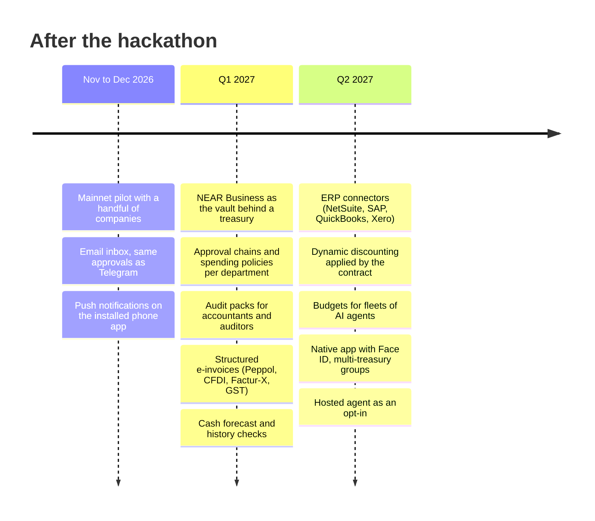

# Roadmap

What Bursar does today is in the [README](README.md): every feature there has a "do X, see Y" step you can run. This page is what comes after the NEAR HACKATHON (November 1 to 14, 2026). Dates are quarters, not promises; the order is the point. The principle does not move: the AI reads, the contract decides, a dumb executor moves the money.

## November to December 2026: from demo to pilot

- **Mainnet pilot.** A handful of companies run a treasury with real USDC, each on its own contract with its own keys. Their first cross-chain payouts through NEAR Intents (Base first, as in our own mainnet payments of 2 and 3 November), watched by hand before the executor is left alone at their volumes.
- **Email inbox.** Vendors mail the invoice to the treasury's own address; it lands in the same inbox as Telegram, with the same approvals and the same outcomes. Nothing changes for the contract.
- **Push notifications.** The console already installs on a phone (README step 9a) and approves in bulk ("Approve selected" in Attention, "approve all" on Telegram, step 9h). Next, the installed app tells you when an invoice is held or paid, with the same code.

## Q1 2027: larger companies

- **NEAR Business as the vault.** The multisig holds the funds and votes on the exceptions; it tops up the operating contract that Bursar runs. Bursar keeps doing the reading and the policy. The escalation hook already exists: when a treasury has a Sputnik DAO, its held invoices go there as proposals the contract opens.
- **Approval chains and policies per department.** A hold can require two named people or a person of a given role without a DAO (a DAO council can already require a majority); caps and budgets can differ by cost center. All of it on the contract, all of it events.
- **Audit packs for accountants and auditors.** The console already exports payments to Excel and CSV (README step 9b). Next, a period becomes a ledger with the enclave receipts attached, in the formats accountants import.
- **Structured e-invoices.** Where a country mandates a format (Peppol, CFDI in Mexico, Factur-X, India's GST e-invoice, and the others), the reading step becomes a deterministic parser and the contract decides the same way. PDFs stay for everywhere else.
- **Cash forecast and history checks.** Commitments of the next 30 days against the balance, computed from the contract's own data (holds, queue, standing orders) and the due dates the claims carried, shown before anyone approves; flags from the history (an amount out of scale for that vendor, two vendors sharing a payout or a tax id). Arithmetic, no AI, and the contract still decides.

## Q2 2027: the finance stack around it

- **ERP connectors.** NetSuite, SAP, QuickBooks and Xero: vendors and purchase orders flow in, decisions and payments flow back out as entries.
- **Dynamic discounting.** Early-payment terms recorded on the vendor; the contract applies them when it pays early. No negotiation between agents, just terms the owner wrote down.
- **Budgets for fleets of AI agents.** One function-call key and one budget per agent, so a company can let many agents request payments and still have one gate.
- **Native app.** Face ID for the keys, the phone's keychain instead of browser storage, the camera for paper invoices, real push notifications. Approvals from the phone then carry the wallet's own signature; Telegram stays for vendors.
- **Multi-treasury groups and a hosted agent.** A parent view over several treasuries, and a hosted agent for companies that do not want to run one, as an opt-in that keeps the keys in their contract.

## What stays out

- Investment strategies for the treasury: that is financial advice and a step toward custody. At most an owner's rule such as "keep X, send the surplus to the registered address Y".
- Payments to creators or payroll: other products.
- A percentage on payments: Bursar is software, not a payment service. The subscription is meant to be paid by the treasury itself, Bursar as a registered vendor with a standing order, within the customer's own limits.
